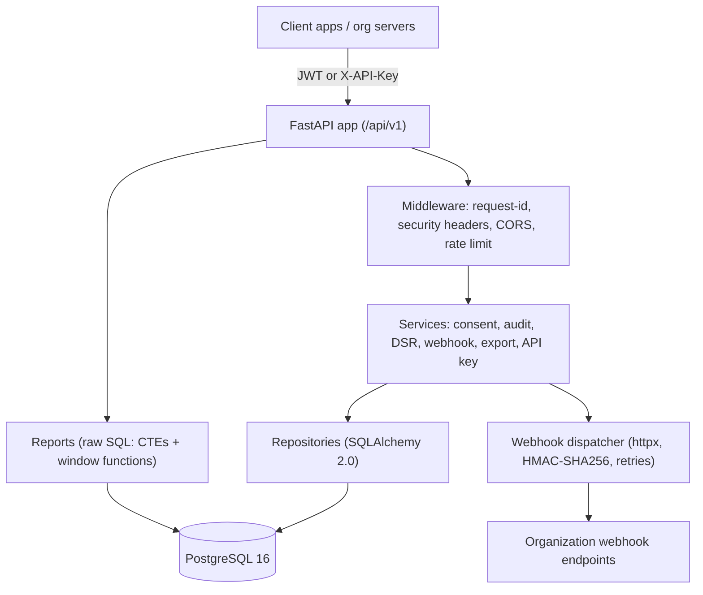
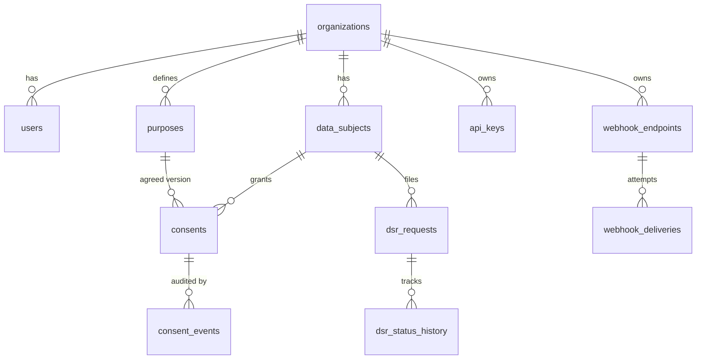
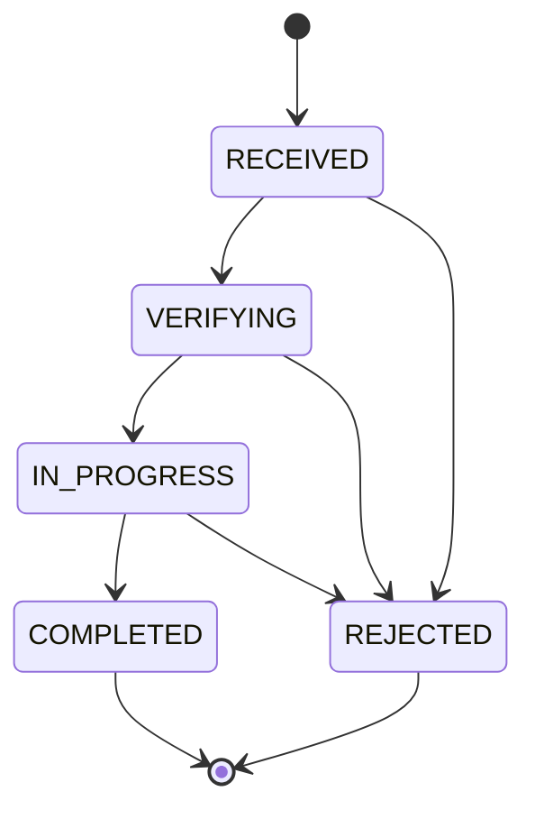

# ConsentVault

A Consent & Data Privacy Management API built with **FastAPI + PostgreSQL**, following GDPR and India's DPDP Act principles: purpose limitation, explicit consent, easy withdrawal, auditability, and data subject rights.

Organizations (tenants) collect user consent for specific purposes (marketing, analytics, personalization, third-party sharing). ConsentVault records consent grants and withdrawals, keeps a **tamper-evident, hash-chained audit trail**, and handles data subject requests (access, export, deletion, correction) through a tracked workflow with SLA deadlines.

## Architecture



Layering: `api/v1` (HTTP) → `services` (business rules) → `repositories` (queries) → `models` (SQLAlchemy typed ORM). Background work (webhook retries, expiry sweep) runs through a small service layer that can be swapped for Celery later; the API triggers sweeps via `POST /admin/sweep-expired` and `POST /webhooks/retry-pending`.

## Data model



Key constraints: UUID primary keys everywhere; `UNIQUE(organization_id, email)` on users; `UNIQUE(organization_id, external_ref)` on data subjects; `UNIQUE(organization_id, code, version)` on purposes; a **partial unique index** allows only one `GRANTED` consent per (subject, purpose); `(organization_id, created_at)` index on consent events; a partial index on pending DSRs; GIN index on the JSONB event metadata.

## Tamper-evident audit log

`consent_events` is **append-only**:

1. A PostgreSQL trigger (`consent_events_append_only`, installed by Alembic migration `a1b2c3d4e5f6`) raises an exception on any `UPDATE` or `DELETE`.
2. Each event stores `event_hash = SHA-256(prev_hash + canonical_payload)`, where the canonical payload is sorted-key compact JSON of the event fields. `prev_hash` is the previous event's hash **for the same organization** (genesis = 64 zeros), forming a hash chain per tenant.
3. `GET /api/v1/audit/verify-chain` recomputes the whole chain and returns `{"intact": true}` or the first broken event id.

A test (`test_tamper_detection_breaks_chain`) disables the trigger, rewrites a row, and proves verification then fails — so even a privileged attacker who bypasses the trigger cannot hide the edit.

## DSR workflow



Transitions are enforced server-side (illegal jumps return **422**) and every change is written to `dsr_status_history`. `due_date = created_at + DSR_SLA_DAYS` (default 30). On completion:

- **ACCESS / EXPORT** — a JSON bundle (profile, consents, full history, DSR records) is generated and downloadable via `GET /dsr/{id}/download`.
- **DELETE** — the data subject is **anonymized**: email and external_ref are replaced with irreversible `anon_<sha256>` hashes and PII is nulled. Consent events reference the subject by UUID only and contain no email, so anonymization does **not** break the hash chain, while legally required consent records are retained in anonymized form. This is verified by `test_dsr_delete_anonymizes_but_chain_stays_valid`.
- **CORRECTION** — marked fulfilled with a result reference.

## Roles & permissions

| Permission | super_admin | org_admin | dpo | data_subject |
|---|---|---|---|---|
| org:manage | ✅ | — | — | — |
| apikey:manage | ✅ | ✅ | — | — |
| purpose:manage | ✅ | ✅ | — | — |
| purpose:read | ✅ | ✅ | ✅ | ✅ |
| consent:manage | ✅ | ✅ | — | — |
| consent:read | ✅ | ✅ | ✅ | ✅ |
| consent:check | ✅ | ✅ | ✅ | — |
| audit:read | ✅ | ✅ | ✅ | — |
| dsr:manage | ✅ | ✅ | ✅ | — |
| dsr:create | ✅ | ✅ | ✅ | ✅ |
| webhook:manage | ✅ | ✅ | — | — |
| report:read | ✅ | ✅ | ✅ | — |

RBAC is enforced by reusable FastAPI dependencies (`require_permission` / `require_role` in `app/core/permissions.py`). API keys carry scopes (`"*"` or explicit permission names) checked on every server-to-server call.

## Tenant isolation

Every query is scoped by `organization_id` taken from the authenticated principal (JWT user or API key) — never from client input. Cross-tenant reads return **404** (existence is not leaked). `tests/integration/test_tenant_isolation.py` proves tenant A cannot read or modify tenant B's purposes, consents, DSRs, webhooks, audit events, organizations, API keys, or reports.

## Quick start

### Docker (recommended)

```bash
cp .env.example .env   # set a real SECRET_KEY
docker compose up --build
# Swagger UI: http://localhost:8000/docs   Health: http://localhost:8000/api/v1/health
```

Compose starts PostgreSQL 16 + the app; migrations (including the audit trigger) run automatically on boot.

### Local

```bash
python -m venv .venv && source .venv/bin/activate
pip install -e ".[dev]"
cp .env.example .env
alembic upgrade head
uvicorn app.main:app --reload
```

### Makefile

`make up` · `make down` · `make migrate` · `make seed` · `make test` · `make lint` · `make benchmark`

## API examples

```bash
# 1) Register an organization + admin user
curl -X POST localhost:8000/api/v1/auth/register -H 'Content-Type: application/json' -d '{
  "organization_name": "Acme", "organization_slug": "acme",
  "email": "admin@acme.example", "password": "Password123!", "role": "org_admin"}'
# -> {"access_token": "...", "refresh_token": "..."}
TOKEN=<access_token>

# 2) Create a purpose
curl -X POST localhost:8000/api/v1/purposes -H "Authorization: Bearer $TOKEN" \
  -H 'Content-Type: application/json' -d '{
  "code": "marketing", "name": "Marketing", "description": "Marketing emails",
  "legal_basis": "CONSENT", "is_required": false, "retention_days": 365}'

# 3) Grant consent (idempotent; multiple purposes in one call)
curl -X POST localhost:8000/api/v1/consents -H "Authorization: Bearer $TOKEN" \
  -H 'Content-Type: application/json' -d '{
  "external_ref": "user-42", "email": "user42@example.com",
  "purposes": [{"purpose_code": "marketing"}], "source": "web"}'

# 4) Check consent (fast, indexed; also works with X-API-Key)
curl -X POST localhost:8000/api/v1/consents/check -H "Authorization: Bearer $TOKEN" \
  -H 'Content-Type: application/json' -d '{"external_ref": "user-42", "purpose_code": "marketing"}'
# -> {"has_consent": true, "status": "GRANTED", ...}

# 5) Withdraw consent (409 for required purposes, with explanation)
curl -X POST localhost:8000/api/v1/consents/<consent_id>/withdraw -H "Authorization: Bearer $TOKEN"

# 6) Create + complete a DSR export, then download the bundle
curl -X POST localhost:8000/api/v1/dsr -H "Authorization: Bearer $TOKEN" \
  -H 'Content-Type: application/json' -d '{"external_ref": "user-42", "type": "EXPORT"}'
curl -X PATCH localhost:8000/api/v1/dsr/<dsr_id>/status -H "Authorization: Bearer $TOKEN" \
  -H 'Content-Type: application/json' -d '{"status": "VERIFYING"}'
curl -X PATCH localhost:8000/api/v1/dsr/<dsr_id>/status -H "Authorization: Bearer $TOKEN" \
  -H 'Content-Type: application/json' -d '{"status": "IN_PROGRESS"}'
curl -X PATCH localhost:8000/api/v1/dsr/<dsr_id>/status -H "Authorization: Bearer $TOKEN" \
  -H 'Content-Type: application/json' -d '{"status": "COMPLETED"}'
curl localhost:8000/api/v1/dsr/<dsr_id>/download -H "Authorization: Bearer $TOKEN" -o export.json

# 7) Verify the audit chain
curl localhost:8000/api/v1/audit/verify-chain -H "Authorization: Bearer $TOKEN"
```

Full endpoint list: auth (`register/login/refresh/me`), organizations + API keys, purposes (versioned CRUD), consents (grant/withdraw/check/subject views/history), audit (`verify-chain`, events), DSR (CRUD, status machine, history, download, overdue), webhooks (CRUD, deliveries, retry), reports (`consent-rates`, `withdrawal-trends`, `dsr-sla`), admin sweep, health.

## Security notes

- Passwords: bcrypt. API keys: only the SHA-256 hash is stored, compared in constant time; the raw key is shown **once** at creation. Webhook secrets are never returned after creation.
- Webhooks are signed with HMAC-SHA256 (`X-ConsentVault-Signature`), retried with exponential backoff (2, 4, 8, 16, 32s; max 5 attempts), and every attempt is recorded.
- PII is never logged: emails/IPs are masked in structured JSON logs. Every response carries an `X-Request-ID`. Security headers (HSTS, `X-Content-Type-Options`, `X-Frame-Options`, CSP) and strict CORS are set by middleware. Auth and consent endpoints are rate-limited (in-memory limiter behind a `RateLimiter` interface, ready to swap for Redis).
- Purpose versioning: editing a purpose's description or legal basis creates a **new version**; existing consents keep pointing at the version the subject actually agreed to. Required purposes return **409** on withdrawal with a documented alternative flow (DPO contact / account deletion via DSR DELETE).

## Seed & benchmarks

```bash
python scripts/seed_data.py --scale 1.0   # 3 orgs, 50K+ subjects, 300K+ events, 5K DSRs
python scripts/seed_data.py --scale 0.04  # quick local seed
python scripts/benchmark_queries.py       # EXPLAIN (ANALYZE, BUFFERS) before/after indexing -> docs/benchmarks.md
```

Measured results (PostgreSQL 16, local; 1,998 subjects / 3,996 consents / 4,581 events / 200 DSRs seeded at `--scale 0.04`). Full numbers in [docs/benchmarks.md](docs/benchmarks.md):

| Query | Before EXPLAIN (ms) | Before wall median (ms) | After EXPLAIN (ms) | After wall median (ms) |
|---|---|---|---|---|
| consent_check | 0.069 | 0.593 | 0.050 | 0.647 |
| report_consent_rates | 5.831 | 9.867 | 3.310 | 3.175 |
| report_withdrawal_trends | 0.486 | 1.210 | 0.235 | 0.752 |
| report_dsr_sla | 0.213 | 0.841 | 0.197 | 0.745 |

## Tests

```bash
pytest tests/ --cov=app --cov-report=term-missing --cov-fail-under=80
```

54 tests (unit: hash chain, DSR state machine, API keys, webhook signatures, consent rules; integration: every endpoint, auth failures, RBAC, tenant isolation, idempotent grants, trigger enforcement, tamper detection, export contents, anonymization, webhook retries via respx, reports). CI (`.github/workflows/ci.yml`) runs ruff, mypy, and pytest with a PostgreSQL 16 service container, failing below 80% coverage.

## Design decisions & trade-offs

- **Hash chain per organization** (not global): verification stays O(org events), tenants can't interfere with each other's chains, and chain order is defined by `(created_at, id)`.
- **Anonymize, don't hard-delete**: GDPR/DPDP deletion is satisfied by irreversible hashing of identifiers while the audit trail and legally required consent records survive — deleting events would destroy auditability.
- **404 for cross-tenant access**: avoids leaking whether another tenant's resource exists.
- **In-memory rate limiter + BackgroundTasks-style dispatch**: keeps the stack dependency-light; both sit behind small interfaces (`RateLimiter`, `WebhookService`) so Redis/Celery can replace them without API changes.
- **Raw SQL reports** in `app/sql/*.sql`: CTEs and window functions (running totals, moving averages, percentiles) stay reviewable and tunable by DBAs, always parameterized.
- **API key scopes default to `["*"]`**: convenient for first-party servers; scope keys down (`["consent:check"]`) for least-privilege integrations.

## Deployment (Render / Railway)

1. Create a PostgreSQL 16 database; copy its connection string.
2. Deploy this repo as a Docker web service (the multi-stage `Dockerfile` runs migrations on boot and serves on port 8000; set the platform port to 8000).
3. Set env vars: `DATABASE_URL=postgresql+psycopg://...`, `SECRET_KEY` (long random value), `CORS_ORIGINS=https://your-frontend.example`, optionally `DSR_SLA_DAYS`.
4. Health check path: `/api/v1/health`. Swagger at `/docs`.
5. Run `python scripts/seed_data.py --scale 0.02` once if you want demo data.

## Project structure

```
app/
  main.py            FastAPI app, middleware, exception handlers
  core/              config, security (JWT/bcrypt/API keys/HMAC), logging, permissions, exceptions
  db/                SQLAlchemy base + session
  models/            organizations, users, subjects, purposes, consents, events, DSRs, keys, webhooks
  schemas/           Pydantic v2 request/response models
  repositories/      query layer
  services/          consent, audit (hash chain), DSR, webhook, export, API key
  api/v1/            auth, organizations, purposes, consents, audit, dsr, webhooks, admin, health
  middleware/        request id, security headers, rate limit
  sql/               raw report SQL (CTEs + window functions)
alembic/             migrations (incl. append-only trigger)
scripts/             seed_data.py, benchmark_queries.py
tests/               unit/ + integration/ (separate test database)
```
